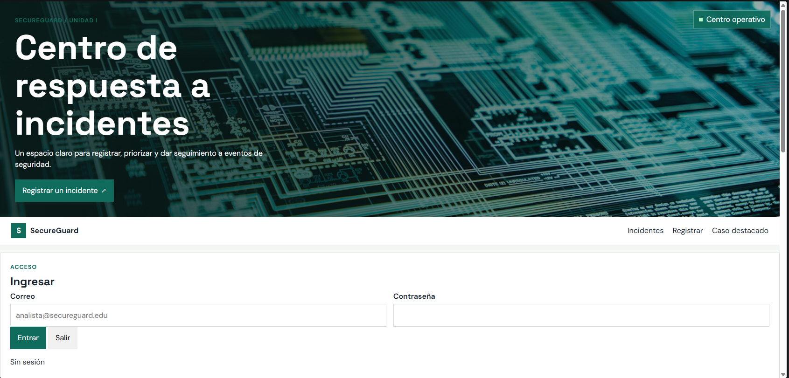
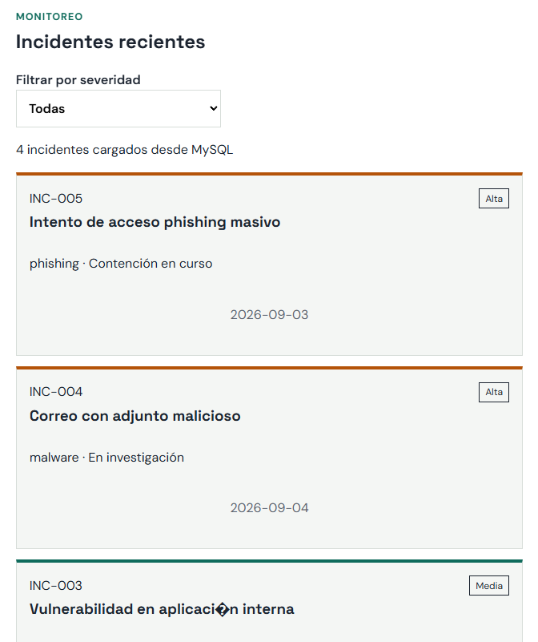
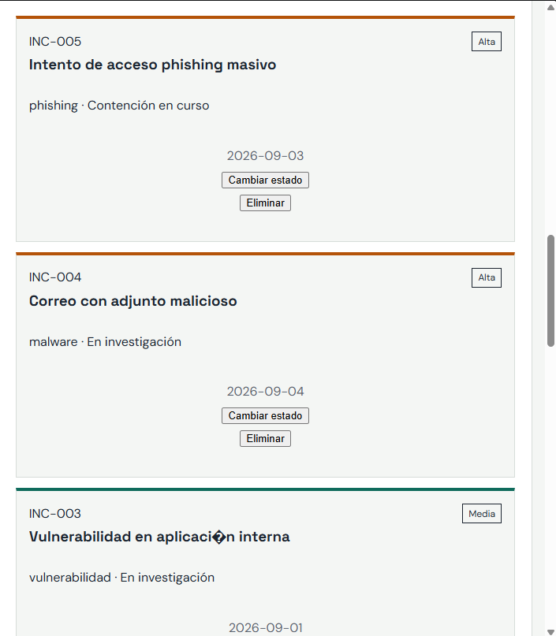

# DM de correcciones — SecureGuard, Semana 6

Se atendieron los hallazgos de seguridad, CRUD e integración. Las capturas de evidencia continúan en `evidencias/`; se incluyen aquí las tres capturas de interfaz para que queden visibles junto con el detalle de cambios.

## Cambios realizados

| Hallazgo | Archivo y función | Corrección |
|---|---|---|
| PATCH/PUT aceptaban cualquier propiedad del cuerpo | [`src/validation/incidentes.js`](./src/validation/incidentes.js): `validarParche`, `validarReemplazo` y `validarCreacion`; [`src/controllers/incidentes.controller.js`](./src/controllers/incidentes.controller.js): `crear`, `actualizar` | Se agregó validación de objeto, allowlist de propiedades, tipos, límites de texto, severidad, estado y fecha. PATCH acepta solo `estado`. PUT requiere el conjunto completo de campos editables. Se rechazan propiedades internas como `id` y `codigo` con HTTP 400. |
| Prisma recibía propiedades copiadas desde la petición | [`src/models/incidentes.model.js`](./src/models/incidentes.model.js): `actualizar` | Se reemplazó la copia general del objeto por una lista explícita de campos que el modelo puede actualizar. |
| XSS almacenado en las tarjetas | [`public/js/vista.js`](./public/js/vista.js): `pintarIncidentes` | Se eliminó la interpolación de datos del incidente dentro de `innerHTML`. La tarjeta se crea con elementos DOM, `textContent`, atributos asignados de forma explícita y severidad limitada a clases conocidas. |
| Un `401` dejaba la sesión y el token guardados; los `403` eran poco claros | [`public/js/modelo.js`](./public/js/modelo.js): `pedir`; [`public/js/controlador.js`](./public/js/controlador.js): evento `sesion-expirada` | Para respuestas 401 de `/incidentes`, se limpia `sessionStorage`, se actualiza la interfaz y se lleva al usuario al formulario de inicio de sesión. Un 403 muestra un mensaje de permisos y conserva la sesión. Los errores de credenciales del login siguen mostrando el mensaje de la API. |
| El servidor aceptaba un secreto JWT débil | [`server.js`](./server.js), validación de configuración; [`.env.example`](./.env.example) | El servidor ahora exige 64 caracteres hexadecimales para `JWT_SECRET` y muestra el comando para generar 32 bytes aleatorios. No se incluyeron valores de secretos en este documento. |
| El formulario enviaba un campo de confirmación que solo pertenece a la interfaz | [`public/js/controlador.js`](./public/js/controlador.js): envío de `formulario` | Se excluye `confirmacion` del JSON enviado; la validación HTML del checkbox permanece activa. |
| No había pruebas de las reglas nuevas | [`tests/incidentes-validation.test.js`](./tests/incidentes-validation.test.js); [`package.json`](./package.json) | Se añadió `npm test` con casos para creación válida, propiedades desconocidas, datos inválidos, PATCH limitado a estado y PUT completo. |
| El ZIP de entrega podía incluir archivos que Git ignora | [`README.md`](./README.md), sección “Seguridad del repositorio” | Se aclaró que `.gitignore` no excluye archivos de una copia manual y que credenciales o claves compartidas anteriormente deben rotarse. `.env`, `certs/` y archivos PEM ya están ignorados y no aparecen como archivos rastreados en Git. |

## Código principal modificado

**Validación por método** — `src/controllers/incidentes.controller.js`, función `actualizar`:

```js
const cambios = req.method === "PATCH"
    ? validarParche(req.body)
    : validarReemplazo(req.body);
const actualizado = await modelo.actualizar(req.params.id, cambios);
```

**Campos Prisma permitidos** — `src/models/incidentes.model.js`, función `actualizar`:

```js
const data = {};
const camposPermitidos = ["titulo", "descripcion", "severidad", "prioridad", "estado", "tipo", "fecha"];
for (const campo of camposPermitidos) {
    if (Object.hasOwn(cambios, campo)) data[campo] = cambios[campo];
}
```

**Salida del título como texto** — `public/js/vista.js`, función `pintarIncidentes`:

```js
const titulo = document.createElement("h3");
titulo.textContent = incidente.titulo;
tarjeta.append(encabezado, titulo, detalle, pie);
contenedor.replaceChildren(...tarjetas);
```

**Sesión vencida y permiso denegado** — `public/js/modelo.js`, función `pedir`:

```js
if (respuesta.status === 401 && ruta.startsWith("/incidentes")) {
    cerrarSesion();
    window.dispatchEvent(new Event("sesion-expirada"));
    throw new Error("Tu sesión venció o dejó de ser válida. Inicia sesión nuevamente.");
}
if (respuesta.status === 403) {
    throw new Error("No tienes permisos para realizar esta acción con tu rol.");
}
```

## Verificación y evidencia

Las pruebas automatizadas cubren validación del cuerpo y los límites de actualización. La interfaz conserva la carga, creación y botones por rol; además, ahora presenta una tarjeta usando texto seguro. `.env` y `certs/key.pem` están presentes localmente, pero Git los ignora y no están rastreados; se dejaron intactos en el equipo y no deben copiarse a la entrega.

### Capturas de interfaz existentes

**Inicio de sesión**



**Vista de analista**



**Vista de administrador**



Las capturas API 01–08 permanecen en `evidencias/` (login, autenticación, permisos, validación, alta, actualización y persistencia).

## Nota para la entrega del informe

El único informe original encontrado en la carpeta es `T1S6_SecureGuard_Carriel.pdf`; no se encontró un documento editable de origen. Este DM documenta las correcciones y muestra las capturas de interfaz, pero el PDF original no fue remaquetado. Antes de volver a entregar, actualiza ese PDF desde el archivo fuente editable si está disponible e incorpora en él las capturas de `evidencias/`. Comprueba también que no incluya `.env` ni `certs/key.pem`. Si cualquiera de esos secretos ya se compartió, cámbialo aunque ahora esté excluido de Git.
