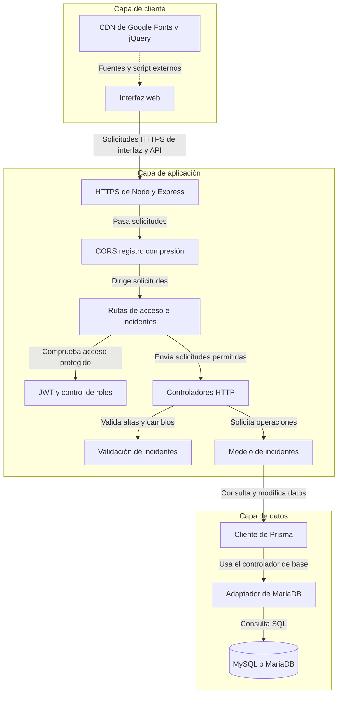

# Diagrama de arquitectura

SecureGuard es una aplicación web académica para gestionar incidentes. La interfaz del navegador consume una API de Express mediante HTTPS; esta autentica a la persona usuaria y comprueba su rol antes de validar las operaciones y guardar los datos en MySQL mediante Prisma.

## Arquitectura de la aplicación

<!-- mermaid-checked: no \n, no em-dash/en-dash, no {} in labels, subgraphs are id["label"], arrows are -->|"label"|, all subgraphs closed by end, ids unique -->

### Resumen de tecnologías

| Capa | Tecnología | Versión | Propósito |
|---|---|---|---|
| Entorno de ejecución | Node.js | 20+ según README; Node 26 en el equipo probado | Ejecuta el servidor y las herramientas |
| API web | Express | 4.21.2 | Rutas, middleware JSON y archivos estáticos |
| Transporte | HTTPS de Node | Entorno de Node | Canal TLS local |
| Navegador | HTML, CSS y módulos ES | Nativo del navegador | Formularios, lista de incidentes e interfaz |
| Recursos del navegador | Google Fonts, Unsplash y CDN de jQuery | Servicios externos | Fuentes, imagen principal y script heredado |
| Autenticación | jsonwebtoken | 9.0.3 | JWT firmado con duración de dos horas |
| Almacenamiento de contraseñas | bcryptjs | 3.0.3 | Hash y comparación de contraseñas |
| ORM | Cliente y CLI de Prisma | 7.10.0 | Esquema, migraciones y consultas |
| Adaptador de base de datos | @prisma/adapter-mariadb | 7.10.0 | Conexión con MariaDB/MySQL |
| Base de datos | MySQL o MariaDB | Depende de la instalación | Persistencia de usuarios e incidentes |
| Validación | Módulo JavaScript del proyecto | Interna | Reglas de negocio en el servidor |
| Calidad | Jest | 30.5.2 | Pruebas unitarias |
| Calidad | ESLint | 10.12.0 | Análisis estático |
| Compresión | compression | 1.8.2 | gzip para respuestas HTTP elegibles |

### Almacenamiento de datos y servicios externos

La base relacional es MySQL/MariaDB, accedida mediante el cliente de Prisma y el adaptador de MariaDB. Almacena registros de `Incidente` y `Usuario`; la aplicación no usa caché ni intermediario de mensajes. El HTML del navegador referencia Google Fonts, una imagen de Unsplash y jQuery desde redes de distribución de contenido (CDN). Son recursos de presentación, no API de negocio. La base de datos no estuvo disponible para una nueva ejecución integral; por tanto, las pruebas unitarias locales no demuestran conectividad actual con la base.

### Decisiones arquitectónicas

- El servidor separa rutas, controladores HTTP, validación de negocio, modelo de datos y middleware de seguridad.
- La interfaz estática se sirve únicamente desde `public/`, de modo que la raíz del servidor y los archivos privados locales no se publican como recursos web.
- Los códigos de incidente se calculan a partir del identificador autoincremental dentro de una transacción Prisma, evitando la colisión causada anteriormente al leer el último código e incrementarlo.

## Relaciones entre componentes

```mermaid
flowchart LR
    subgraph PresentationLayer["Presentación"]
        cHtml["HTML principal y de detalle"]
        cBrowserController["Controlador del navegador"]
        cBrowserModel["Cliente de API del navegador"]
        cBrowserView["Vista del navegador"]
    end
    subgraph HttpLayer["HTTP y seguridad"]
        cServer["Servidor HTTPS con Express"]
        cAuthRoutes["Rutas y controlador de acceso"]
        cIncidentRoutes["Rutas de incidentes"]
        cAuthMiddleware["Middleware JWT y roles"]
        cIncidentController["Controlador de incidentes"]
        cValidation["Validación de incidentes"]
        cError["Middleware de errores y 404"]
        cLogger["Registro de solicitudes"]
    end
    subgraph DataLayer["Acceso a datos"]
        cIncidentModel["Modelo Prisma de incidentes"]
        cPrisma["Cliente y adaptador Prisma"]
        cDatabase[("MySQL o MariaDB")]
    end
    cHtml -->|"Carga módulos"| cBrowserController
    cBrowserController -->|"Usa funciones de API"| cBrowserModel
    cBrowserController -->|"Actualiza el DOM"| cBrowserView
    cBrowserModel -->|"Solicitudes JSON por HTTPS"| cServer
    cServer -->|"Monta ruta de acceso"| cAuthRoutes
    cServer -->|"Monta rutas protegidas"| cAuthMiddleware
    cAuthMiddleware -->|"Autoriza roles válidos"| cIncidentRoutes
    cIncidentRoutes -->|"Envía operaciones CRUD"| cIncidentController
    cIncidentController -->|"Valida entradas"| cValidation
    cIncidentController -->|"Lee y modifica datos"| cIncidentModel
    cIncidentModel -->|"Consulta mediante adaptador"| cPrisma
    cPrisma -->|"Ejecuta consultas SQL"| cDatabase
    cServer -.->|"Registra respuestas completadas"| cLogger
    cServer -.->|"Gestiona rutas y errores"| cError
```

<!-- mermaid-checked: no \n, no em-dash/en-dash, no {} in labels, subgraphs are id["label"], arrows are -->|"label"|, all subgraphs closed by end, ids unique -->

### Inventario de componentes

| Componente | Capa | Tipo | Responsabilidad |
|---|---|---|---|
| `public/index.html`, `public/detalle.html` | Presentación | Páginas HTML | Formulario, acceso, contenedores del listado y ficha demostrativa estática |
| `public/js/controlador.js` | Presentación | Controlador del navegador | Eventos de interfaz, validación inicial y coordinación entre API y vista |
| `public/js/modelo.js` | Presentación | Cliente de API | Sesión del navegador y solicitudes HTTP |
| `public/js/vista.js` | Presentación | Funciones de vista | Construye tarjetas y actualiza resúmenes |
| `server.js` | HTTP | Inicio de aplicación | Configura HTTPS, Express, CORS, middleware y rutas |
| `src/routes/auth.routes.js` | HTTP | Enrutador | Asocia la ruta de inicio de sesión |
| `src/controllers/auth.controller.js` | HTTP | Controlador | Comprueba credenciales y devuelve JWT |
| `src/routes/incidentes.routes.js` | HTTP y seguridad | Enrutador | Asocia operaciones CRUD y permisos por rol |
| `src/security/rol.js` | Seguridad | Componente intermedio | Autentica JWT y aplica permisos |
| `src/security/token.js` | Seguridad | Utilidad | Firma y verifica JWT |
| `src/security/hash.js` | Seguridad | Utilidad | Genera y compara resúmenes criptográficos bcrypt |
| `src/controllers/incidentes.controller.js` | Negocio y HTTP | Controlador | Convierte operaciones API en llamadas al modelo y respuestas |
| `src/validation/incidentes.js` | Negocio | Validador | Aplica contratos de entrada y reglas de valores |
| `src/models/incidentes.model.js` | Acceso a datos | Modelo | Consulta y modifica incidentes mediante Prisma |
| `src/lib/prisma.js` | Infraestructura | Cliente de base de datos | Configura Prisma y el adaptador MariaDB desde el entorno |
| `src/middleware/logger.js` | Infraestructura | Componente intermedio | Registra método, URL, estado y duración |
| `src/middleware/errorHandler.js` | Infraestructura | Componente intermedio | Devuelve errores JSON y respuestas 404 coherentes |
| `prisma/schema.prisma` | Acceso a datos | Esquema ORM | Describe las tablas de incidentes y usuarios |
| `prisma/migrations/` | Acceso a datos | Migraciones SQL | Crea y evoluciona tablas relacionales |
| `src/seed.js` | Operaciones | Carga inicial | Crea o actualiza cuentas locales de demostración |
